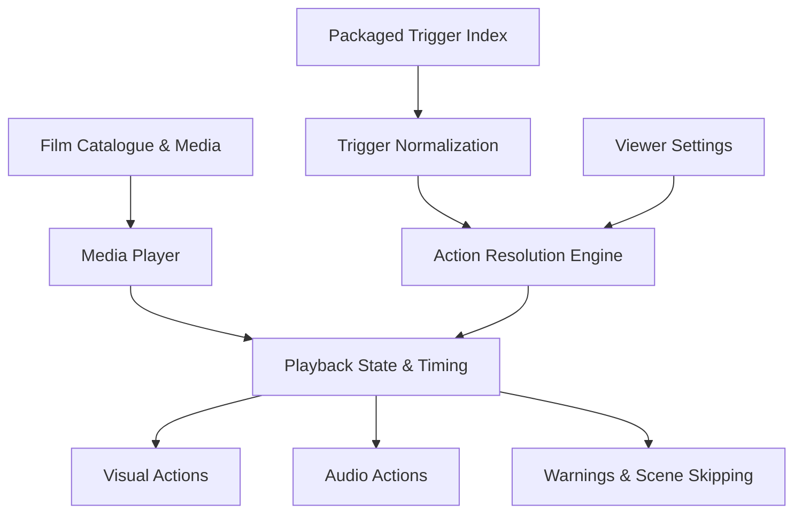

# 🎬 Trigger-Aware Player

> **A viewer-controlled media player for Amazon Fire TV running Vega OS.**
>
> Customize how selected moments in a film are presented through trigger-aware visual and audio protections.

Trigger-Aware Player is a React Native application that plays the original film and applies viewer-selected actions to supported moments using time-based trigger data. Instead of generating a separate edited version of a film, it gives viewers control over how selected content is handled during playback.

## ✨ Key Features

- 🎞️ **Film Playback** — Play supported films in a player designed for Amazon Vega OS.
- 🎯 **Trigger-Aware Actions** — Apply actions to specific time intervals associated with supported content categories.
- ⚙️ **Per-Trigger Customization** — Configure available responses for individual trigger categories.
- 🔇 **Audio Protection** — Mute audio or reduce volume for supported intervals.
- 🖥️ **Visual Protection** — Hide selected visual content using the available visual mitigation behavior.
- ⏭️ **Scene Skipping** — Skip supported intervals according to the selected action and playback rules.
- 🔔 **Heads-Up Warnings** — Display warnings where supported by the action engine and player interface.
- 🎛️ **Viewer Preferences** — Configure trigger categories and action responses instead of relying only on fixed defaults.
- 🧪 **Detection and Evaluation Tools** — Develop, test, and evaluate trigger detection and cue-processing workflows.
- 📺 **Vega OS Integration** — Build and test the application using the Amazon Vega OS development toolchain.

*Available actions depend on the trigger contract, packaged cue data, implementation status, and device capabilities. Visual hiding may use a blackout fallback rather than blur.*

## 🏗️ Architecture

The application connects time-based trigger data to viewer preferences and playback actions.



### How It Works

1. **Load the film:** The application selects a supported film and its associated cue index.
2. **Read trigger cues:** The engine processes trigger categories and their time intervals.
3. **Resolve the action:** Viewer preferences are combined with the canonical trigger contracts to determine the applicable response.
4. **Apply during playback:** The player applies supported actions at the relevant intervals.
5. **Restore playback state:** Actions must be handled carefully across interval boundaries, overlapping cues, and seeking.

The application uses packaged cue data; it does not guarantee that every relevant moment in a film will be detected.

## 🧰 Tech Stack

| Component | Technology |
|---|---|
| Application UI | React Native |
| Application logic | TypeScript |
| Target platform | Amazon Fire TV / Vega OS |
| Build and deployment | Amazon Vega OS SDK and CLI |
| JavaScript/TypeScript testing | Jest |
| Detection and evaluation | Python |
| Python testing | pytest |
| Version control | Git and GitHub |

## 📂 Project Structure

```text
PHONY_APP/
├── src/
│   ├── components/     # Player and settings UI
│   ├── engine/         # Trigger contracts and action resolution
│   └── data/           # Film catalogue and application data
├── data/
│   ├── processed/      # Processed film cue data
│   └── benchmark/      # Detection benchmark resources, where present
├── scripts/            # Detection, packaging and evaluation tools
├── test/               # JavaScript and TypeScript tests
├── tests/              # Python tests
├── docs/               # Project and attribution documentation
├── package.json
├── README.md
└── CONTRIBUTING.md
```

*The directory listing is representative; exact files and subdirectories may vary by branch.*

## 📋 Prerequisites

Before setting up the project, install:

- **Git** — to clone and manage the repository.
- **Node.js and npm** — for React Native dependencies and application tooling.
- **Python 3 and pip** — for detection, evaluation, and Python tests.
- **Amazon Vega OS SDK and CLI** — for building and running the application on a supported target.

Node.js 20 was used during development. Python version and package requirements may vary by workflow. Follow Amazon's current official Vega OS documentation for SDK installation and host compatibility.

## 🚀 Installation

### 1. Fork and Clone

Fork this repository on GitHub, then clone your fork:

```bash
git clone https://github.com/YOUR-USERNAME/PHONY_APP.git
cd PHONY_APP
```

Replace `YOUR-USERNAME` with your GitHub username.

### 2. Install JavaScript Dependencies

```bash
npm install
```

If the repository contains a lockfile and you need a reproducible clean installation, use `npm ci` instead.

### 3. Set Up Python

Create a virtual environment:

```bash
python3 -m venv .venv
source .venv/bin/activate
python -m pip install --upgrade pip
```

If `requirements.txt` is present in your checkout, install the project's Python dependencies:

```bash
python -m pip install -r requirements.txt
```

Some detector and evaluation workflows may require a particular Python version, model weights, or additional assets. Check their documentation before running them.

### 4. Configure Vega OS

Install and configure the Amazon Vega OS SDK and CLI according to the official developer documentation.

Check that your development environment recognizes the intended target device or virtual device before attempting deployment.

## 🛠️ Build and Run

### Build a Debug Package

From the repository root, after configuring the Vega toolchain:

```bash
npx react-native build-vega --build-type Debug
```

The Vega build tools produce the application package. The exact output location and device installation commands depend on your installed SDK and configuration.

### Run on a Supported Device

Use the installation and launch commands supported by your Vega SDK version.

The repository may also include helper scripts for starting a virtual device, building, installing, and launching the application. Inspect a script before running it to understand which operations it performs.

## 🎛️ Trigger Actions

Trigger categories and permitted actions are defined by the canonical contracts in the source code.

Depending on the category and current implementation, responses may include:

| Action | Purpose |
|---|---|
| Hide / Blackout | Covers selected visual content during an interval |
| Mute | Silences audio during an interval |
| Reduce Volume | Lowers audio volume during an interval |
| Skip | Moves playback past a selected interval according to playback rules |
| Warn | Displays a heads-up message where supported |

Not every action is available for every trigger. Default actions and permitted alternatives should be taken from the source-code contracts rather than inferred from this table.

Viewer preferences and category settings influence the action resolution process. The resulting behavior also depends on whether the selected film contains the relevant trigger cues.

## 🧪 Testing

The project includes tests for application logic, trigger processing, and Python detection/evaluation workflows.

Run the checks supported by your checkout:

```bash
npm run typecheck
npx jest
python -m pytest
```

If a command is unavailable, inspect `package.json`, the test configuration, and the relevant project documentation.

For changes involving playback behavior, also test on a supported Vega OS device or virtual device when possible.

Important scenarios include:

- Trigger action selection and settings persistence
- Cue timing and interval boundaries
- Overlapping trigger intervals
- Audio restoration after mute or volume reduction
- Seeking across trigger intervals
- Film-specific cue loading
- Correct handling of unsupported or missing cue categories

Automated tests and successful builds do not by themselves prove every playback behavior works correctly on a device.

## 📊 Detection and Evaluation

The repository includes Python tooling for detector development and evaluation.

Depending on the workflow, this tooling can help with:

- Processing detector outputs into time-based cue data
- Evaluating detection results against benchmark annotations
- Reviewing precision, recall, and F1-score
- Inspecting false positives and false negatives
- Improving the quality and consistency of packaged trigger indexes

Detection performance can vary by category and film. Evaluation results should be reported with their benchmark, test conditions, and limitations.

## 🤝 Contributing

Contributions are welcome!

1. Fork the repository.
2. Create a feature branch.
3. Install the required dependencies.
4. Make a focused change and add or update tests.
5. Run the relevant checks.
6. Push your branch to your fork.
7. Open a pull request describing your changes and test results.

Read [CONTRIBUTING.md](CONTRIBUTING.md) for the complete setup, development, testing, and pull request guidelines.

## ⚠️ Limitations

- Trigger coverage depends on the cue data available for each film.
- Detection can produce false positives and false negatives.
- Some actions are constrained by Vega OS capabilities.
- Playback behavior may require additional device-level verification.
- The application does not guarantee detection or mitigation of every relevant moment.

This project is a prototype intended to explore viewer-controlled content handling during playback.

## 📄 License and Media Attribution

See the repository's `LICENSE` file for the application code license.

Films, subtitles, datasets, and model assets may be governed by separate licenses. Verify usage and redistribution rights, preserve required attribution, and consult the relevant documentation before adding or redistributing media.

---

**Built for Amazon Fire TV / Vega OS.**

*Giving viewers more control over how they experience supported media.*